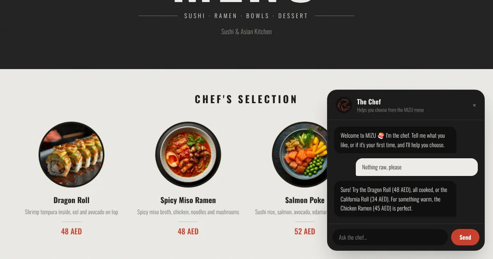

# MIZU Sushi — Menu with an AI Chef

A bilingual Arabic / English sushi menu with an AI chef you can chat with.

**Live:** [mizu-roan.vercel.app](https://mizu-roan.vercel.app) · Part of my [portfolio](https://aya-khamaysa-portfolio.vercel.app)



## Highlights

- **AI chef chat:** explains dishes, avoids raw fish on request, and builds a dinner within a budget, using the real menu and prices.
- **Streaming answers:** replies appear word by word.
- **Secure by design:** the Gemini API key lives only in a Vercel serverless function (`api/assistant.js`), never in the browser.
- Full menu with featured dishes and drinks, English / Arabic (RTL), and a WhatsApp order band.

## Built with

React · Gemini API · Vercel Serverless Functions · Server-Sent Events · Framer Motion · Tailwind CSS · Vite

## Run locally

```bash
npm install
npm run dev
```

The AI chef needs a Gemini API key (free on [Google AI Studio](https://aistudio.google.com)).
On Vercel: **Settings → Environment Variables → `GEMINI_API_KEY`**. Never put the key in the code or commit a `.env` file.
To test the chat locally, run `npx vercel dev` with the key in a local `.env` file.

## Edit
- Menu, prices and dishes: `src/data/menu.js`
- The chef's rules and model: `api/assistant.js`

> MIZU is a fictional restaurant for a portfolio concept.

---

Designed & built by **Aya Khamaysa** · [Portfolio](https://aya-khamaysa-portfolio.vercel.app) · [LinkedIn](https://www.linkedin.com/in/ayakhamaysa) · [One Click](https://www.instagram.com/oneclick.ps)
